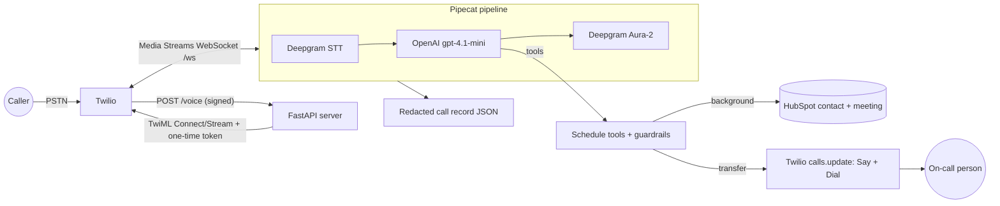
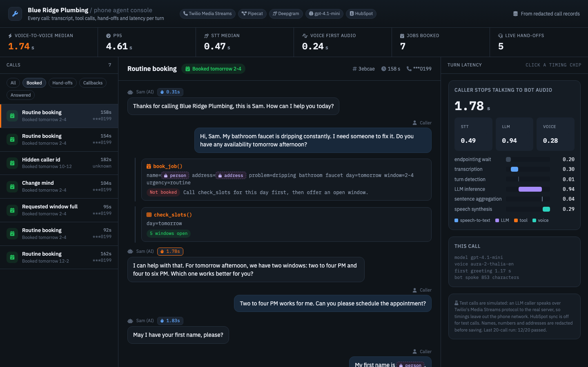

# Blue Ridge Plumbing phone agent

An AI receptionist on a real Twilio phone number, built on an open-source real-time pipeline (Pipecat).
It answers as "Sam" for a demo plumbing company, books jobs on a live schedule, writes the caller and
the job into HubSpot, and hands the call to a person when the caller asks, when there is an emergency,
or when it gets stuck.

No Retell or Vapi: the audio pipeline, telephony, tools, CRM sync and transfer logic are all in this repo.

## What it does

- **Answers the phone.** Twilio streams call audio over a WebSocket (Media Streams) to a Pipecat
  pipeline: Deepgram speech-to-text, OpenAI `gpt-4.1-mini`, Deepgram Aura-2 voice.
- **Books jobs.** Tools `check_slots`, `book_job`, `change_booking` and `request_callback` run against a
  schedule of three trucks and five two-hour windows. Guardrails in code, not just the prompt: no booking
  without checking the day first, no second booking on the same call, no changing someone else's job.
- **Syncs to HubSpot.** Each booking finds or creates the contact by phone number and creates a meeting
  linked to it (association type 200), with the right time window in UTC. Reschedules move the meeting.
  Calls to HubSpot run in the background so the caller never waits on the CRM.
- **Transfers live calls.** `transfer_to_human(reason, summary)` speaks one hold line, then redirects the
  call with Twilio `calls.update` to `<Dial>` the on-call number. The person who answers hears a short
  whisper with the reason and summary first. If nobody answers, the caller is offered a callback and it
  is saved. The serializer is patched so the bot leaving does not hang up the transferred call.
- **Safety first.** Gas smell: tell the caller to leave the house and call the gas company or 911, then
  transfer. Burst pipe, flooding, sewage or no water: shut-off valve advice first, then transfer.
- **Logs and grades every call.** Each call is saved as JSON with the transcript, tool calls, transfer,
  CRM result and per-turn latency (speech-to-text, LLM and voice time to first byte). Names, phone
  numbers and addresses are redacted before saving, including ones spoken as words.

## Architecture



## Results

All numbers below are measured. Calls are **simulated** (see limits): a script speaks Twilio's Media
Streams protocol to the server, and an LLM plays the caller with Deepgram voices on both sides.

**Voice test, 20 calls across 19 scenarios (2026-11-05).** 12 of 20 passed on the first run. Of the
8 failures, 6 were test-harness bugs that are now fixed (the caller talked over the bot's "one sec" line,
and one scenario's board setup was not applied on the server), 1 was a network drop, and 1 was real: speech-to-text heard
"Tom" as "Tong", so the transfer summary had the wrong name.

| Latency (seconds) | Median | p95 | Turns |
|---|---|---|---|
| Caller stops speaking to bot audio, measured on the server | 1.74 | 4.61 | 55 |
| Same, measured by the simulated caller | 1.80 | 4.63 | 69 |
| Speech-to-text, time to final transcript | 0.47 | 0.72 | 55 |
| LLM, time to first token | 0.87 | 1.15 | 55 |
| Voice, time to first audio | 0.24 | 0.44 | 55 |
| Greeting after the call connects | 1.27 | 3.46 | 19 |

**Text test, 19 scenarios x 3 runs.** The same prompt and tools, with an LLM caller and a GPT-4.1 judge
plus rule checks (reply length, digits read as numbers, one question per turn, check before booking,
correct transfer reason). The last three runs passed 56, 56 and 57 of 57.

**Unit tests.** 96 tests: schedule and guardrails, phone and day parsing, HubSpot client against a fake
API, transfer TwiML and serializer, Twilio signature checks, PII redaction. CI runs them on every push.

### Voice cost

The bot spoke 460 characters per call on average (19 calls). At list prices on 2026-11-05:

| Voice | Price | Per call |
|---|---|---|
| Deepgram Aura-2 (used) | $0.030 per 1,000 characters | about $0.014 |
| OpenAI `tts-1` | $15 per million characters | about $0.007 |
| OpenAI `gpt-4o-mini-tts` | about $0.015 per minute (token based) | about $0.008 |

OpenAI voices are roughly half the price per call. This build uses Aura-2 because it ran on Deepgram's
free credit and keeps speech-to-text and voice with one vendor. Swapping the voice is a one-line change
in `app/bot.py`; OpenAI voice latency was not measured.

## Honest limits

- **Simulated calls only.** The Twilio trial only lets verified numbers call in and plays a trial notice,
  so the tests drive the server over the same WebSocket protocol Twilio uses. Latency therefore leaves
  out the phone network between the caller and Twilio; real calls will be somewhat slower.
- **Scripted callers.** The 20 callers are an LLM following personas, not real people. Real callers
  mumble, talk over the bot and have background noise.
- **Transfers were tested in dry-run mode.** The redirect TwiML and the "bot leaves, call stays up" path
  are covered by tests and simulated calls, but no live call was bridged to a phone.
- **Speech-to-text errors reach the CRM.** A misheard name ends up in the transfer summary and the
  contact record. The bot reads addresses back, but not names.
- **Redaction misses names it was not told about.** A caller's first name inside a transfer summary
  ("Marcus has a burst pipe...") can survive redaction; addresses and phone numbers in the same line are caught.
- **The bot sometimes calls `book_job` too early.** In some test calls it tried to book before checking the
  schedule or collecting the caller's details. The code guardrail refused every one of these, and the bot
  then checked the schedule as it should.
- **Demo schedule.** The schedule lives in memory and resets when the server restarts.

## Call console

`docs/console.html` is a static console built from the redacted call records
(`uv run python scripts/build_console.py`): call list with outcomes, the transcript with each tool call
and its result in place, redacted fields shown as chips, live hand-off summaries, and a latency waterfall
for every turn (endpointing, transcription, LLM, tool, speech synthesis).



## Run it

Needs Python 3.12+, [uv](https://docs.astral.sh/uv/), ngrok, and Twilio, Deepgram, OpenAI and
(optionally) HubSpot keys.

```bash
uv sync
cp .env.example .env          # fill in the keys
uv run pytest -q              # unit tests, no keys needed
scripts/dev.sh                # ngrok tunnel + Twilio webhook + server on port 8790
```

Simulated calls and evals (the server must be running with `TRANSFER_DRY_RUN=1`):

```bash
uv run python scripts/sim_call.py --scenario routine_booking
uv run python -m evals.run_voice --calls 20
uv run python -m evals.run_text
```

## Layout

```
app/       server, Pipecat bot, tools, schedule, HubSpot client, transfer, call log, PII redaction
evals/     19 scenarios, text eval runner, voice eval runner
scripts/   dev tunnel, webhook setup, simulated caller, HubSpot check
tests/     unit tests
```

## Security

- Twilio webhook signatures are checked on every endpoint; the media WebSocket needs a one-time token.
- Keys live in a local `.env` that is not committed.
- Logs show only the last four digits of phone numbers; saved transcripts are redacted.
